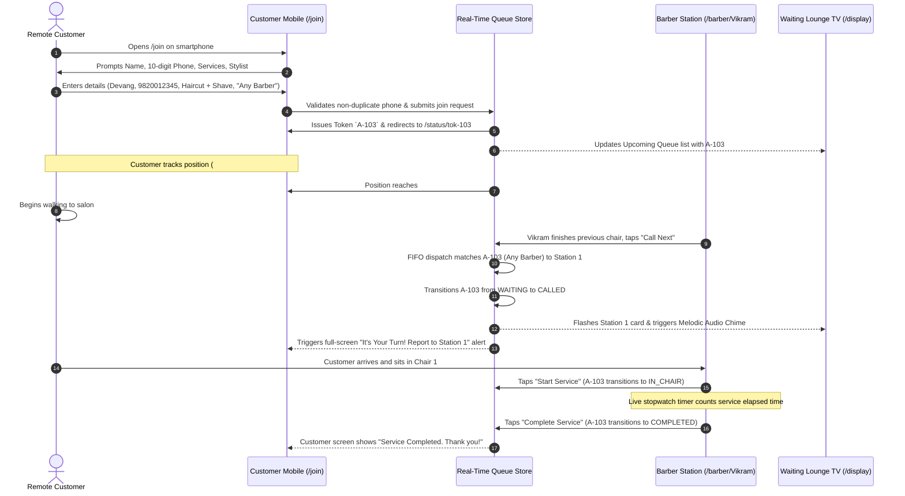

# Queue Flows, Business Logic & Test Rules

## 1. Step-by-Step Scenario Walkthroughs

### 1.1 Scenario 1: Main Remote Customer Flow


---

### 1.2 Scenario 2: Walk-In Customer Flow at Reception
1. **Arrival:** Customer enters the salon lobby without an existing reservation or remote token.
2. **Reception Greeting:** Receptionist opens the Tablet Dashboard (`/reception`) and clicks `+ Register Walk-In`.
3. **Data Entry:**
   * Receptionist inputs customer name (e.g., *"Manish Parekh"*).
   * Optional phone number (if customer wants SMS/link tracker or prefers anonymity).
   * Selects requested services from quick pills (e.g., *Executive Beard Sculpt*).
   * Chooses *Any Barber* or selects a preferred stylist requested verbally.
4. **Token Generation:** System assigns token with prefix `W-` (e.g., `W-106`) and places it strictly at the end of the FIFO queue.
5. **Customer Experience:** Receptionist informs customer: *"Your token is W-106. Please relax in the lounge; your number will flash on the TV screen."*
6. **TV Tracking:** The customer observes their token `W-106` move up the Waiting Area TV Wall (`/display`).

---

### 1.3 Scenario 3: Barber Workstation Lifecycle
```
+-----------------------------------------------------------------------------------------+
|                               BARBER WORKSTATION CYCLE                                  |
+-----------------------------------------------------------------------------------------+
|  [ 1. WAITING / VACANT CHAIR ]                                                          |
|       │                                                                                 |
|       ├─► Action: Barber taps "Call Next in Line"                                       |
|       │                                                                                 |
|  [ 2. CALLED STATE ]                                                                    |
|       │   • Target client token assigned to Station                                     |
|       │   • TV wall flashes station & chimes                                            |
|       │   • Customer mobile alerts                                                      |
|       │                                                                                 |
|       ├─► Action: Customer arrives in chair -> Barber taps "Start Service"              |
|       │                                                                                 |
|  [ 3. IN_CHAIR STATE ]                                                                  |
|       │   • Single-chair lock engaged (cannot call next)                                |
|       │   • Stopwatch timer ticks active duration                                       |
|       │                                                                                 |
|       ├─► Action: Service finishes -> Barber taps "Complete Service"                    |
|       │                                                                                 |
|  [ 4. COMPLETED ] ──► Chair resets to VACANT ──► Return to [ 1 ]                        |
+-----------------------------------------------------------------------------------------+
```

---

### 1.4 Scenario 4: No-Show Handling
1. **Trigger:** Barber calls token `A-104` to Station 2.
2. **Unavailability:** 3 minutes elapse and the client has not arrived at the chair.
3. **Grace Timer Initiated:** Receptionist clicks `Mark Absent / Grace Period` on `/reception`.
4. **10-Minute Countdown:** A 10-minute grace timer begins. On the customer's phone, an alert appears: *"Your token was called! You have 10:00 minutes to report to Station 2 before forfeiture."*
5. **Ejection:**
   * **Branch A (Customer arrives within 10m):** Receptionist clears grace timer; barber taps *"Start Service"*.
   * **Branch B (Timer expires):** Token is automatically ejected and marked `NO_SHOW`. Station 2 is freed.
6. **Late Arrival Remediation:** If the customer arrives 15 minutes later, receptionist can 1-click re-queue them. **Rule:** They do *not* regain their previous position; they are inserted at the **bottom of the current waiting queue** with a fresh token.

---

### 1.5 Scenario 5: Customer Self-Cancellation
1. Remote customer waiting at cafe decides to cancel their visit.
2. Clicks `Leave Queue` on `/status/:id`.
3. Confirmation dialog warns: *"Leaving the queue will permanently forfeit your position #2. Confirm?"*
4. Upon confirmation:
   * State transitions to `CANCELLED`.
   * Queue immediately recalculates positions and wait times for all customers behind them.
   * Phone number lock is instantly freed, allowing them to re-join later if desired.

---

## 2. Queue State Machine & Transition Matrix

### 2.1 State Definitions
* `WAITING`: In line, awaiting barber station assignment.
* `CALLED`: Assigned to a specific station; audio chime triggered; waiting for customer to sit down.
* `IN_CHAIR`: Currently receiving service in the barber chair; timer running.
* `COMPLETED`: Service successfully delivered and finished.
* `CANCELLED`: Voluntarily abandoned by customer or removed by receptionist prior to seating.
* `NO_SHOW`: Forfeited due to failure to arrive within the 10-minute grace window after being called.

### 2.2 Transition Matrix & Guard Rules

```
+---------------+-------------------------------------------------------------------------+
| FROM STATE    | ALLOWED TO STATE      | GUARD CONDITION / RULE                          |
+---------------+-----------------------+-------------------------------------------------+
| WAITING       | CALLED                | Must be matched by barber dispatch FIFO logic   |
| WAITING       | CANCELLED             | Triggered by customer or receptionist override  |
| CALLED        | IN_CHAIR              | Barber taps "Start Service"                     |
| CALLED        | NO_SHOW               | 10-minute grace timer expires without arrival   |
| CALLED        | CANCELLED             | Receptionist manually cancels invalid call      |
| IN_CHAIR      | COMPLETED             | Barber taps "Done / Complete"                   |
| COMPLETED     | (Terminal)            | Read-only state; no transitions permitted       |
| CANCELLED     | (Terminal)            | Read-only state; no transitions permitted       |
| NO_SHOW       | (Terminal)            | Read-only state; re-joining creates NEW token   |
+---------------+-----------------------+-------------------------------------------------+
```

### 2.3 Strict Invariant Enforcement
1. **No Backward Transitions:** A token can never revert from `IN_CHAIR` back to `WAITING`, or from `COMPLETED` back to `IN_CHAIR`.
2. **No Call Skipping:** A token cannot transition directly from `WAITING` to `IN_CHAIR` without entering `CALLED`.
3. **Single-Chair Concurrency Guard:** A barber station can hold at most **one** client in `CALLED` or `IN_CHAIR` state simultaneously. Calling a new token is strictly disabled until the current client transitions to `COMPLETED` or `NO_SHOW`.

---

## 3. Mathematical Wait-Time Forecasting Formula

Wait times are computed dynamically based on the cumulative service minutes of preceding clients, weighted by active working barber bandwidth.

$$\text{Estimated Wait Time} = \frac{\sum_{i=1}^{k} \text{Duration}(T_i)}{N_{\text{active}}}$$

Where:
* $k$ = Total number of waiting clients ahead of the customer.
* $\text{Duration}(T_i)$ = Sum of durations of all selected services for waiting token $T_i$ (in minutes).
* $N_{\text{active}}$ = Number of currently on-duty barbers with status `AVAILABLE` or `BUSY` (excluding barbers `ON_BREAK` or `OFF_DUTY`).

### 3.1 Barber-Specific Calculation
* If a customer selects **"Specific Barber X"**:
  $$\text{Wait Time} = \text{Remaining minutes of Barber X's current chair} + \sum \text{Services of all waiting clients requesting Barber X}$$
* If a customer selects **"Any Barber"**:
  $$\text{Wait Time} = \frac{\text{Sum of all active chair remaining times} + \text{Sum of all general waiting services}}{N_{\text{active}}}$$

### 3.2 Zero-Barber Fallback Guard
If all barbers are marked `ON_BREAK` or `OFF_DUTY` ($N_{\text{active}} = 0$):
* The system prevents division-by-zero errors.
* The wait time badge switches to: `Queue Paused — Stylists Currently on Break`.
* Customer countdown timers pause their countdown until at least one barber returns to `AVAILABLE`.
* Receptionist dashboard displays a persistent warning banner: *"Warning: No active barbers on duty. Queue is paused."*

---

## 4. Smart FIFO Queue Dispatch Algorithm

When Barber $B$ (at Station $S$) clicks `"Call Next in Line"`, the system queries the waiting queue using the following deterministic selection hierarchy:

```
Step 1: Filter queue for tokens in `WAITING` status.
Step 2: Order remaining tokens by `joinedAt` ASC (Strict FIFO).
Step 3: Scan from top to bottom:
        - If Token.barberPreference == B.id  --> MATCH!
        - Else if Token.barberPreference == "ANY" --> MATCH!
        - Else (Token requested another specific barber) --> SKIP and continue down FIFO list.
Step 4: If match found:
        - Set Token.status = "CALLED"
        - Set Token.assignedBarber = B.id
        - Set Token.station = B.station
        - Trigger broadcast events to TV display and customer socket/storage.
Step 5: If no match found:
        - Display toast: "No waiting customers available for this station."
```

This guarantees that a client requesting Barber 2 will **never** be mistakenly called to Barber 1, while customers requesting "Any Barber" act as flexible flow-balancers.

---

## 5. 15-Point Production Verification Test Checklist

| # | Test Scenario / Business Rule | Action / Trigger | Expected Outcome | Status |
| :---: | :--- | :--- | :--- | :---: |
| **01** | **Duplicate Active Phone Guard** | Customer attempts to join `/join` with a phone number currently in `WAITING` or `IN_CHAIR`. | Form blocks submission with inline error; provides link to active `/status/:id`. | PASS |
| **02** | **Max 3 Services Enforcement** | User selects 3 services in `/join` and attempts to check a 4th. | Checkbox 4 is disabled; tooltip informs "Maximum 3 services allowed". | PASS |
| **03** | **Phone Number Validation** | Enters invalid numbers (e.g., `12345`, `abcdef`, `0987654321`). | Submission blocked until exactly 10 digits starting with 6-9 are provided. | PASS |
| **04** | **Specific Barber Dispatch Isolation** | Customer A requests Barber 1. Customer B requests Barber 2. Barber 2 clicks "Call Next". | Customer B is called; Customer A remains #1 in line waiting for Barber 1. | PASS |
| **05** | **"Any Barber" FIFO Priority** | Customer A (Any Barber, 2:00 PM) and Customer B (Barber 1, 2:05 PM). Barber 1 clicks "Call Next". | Customer A is called first because they arrived earlier and chose "Any". | PASS |
| **06** | **Single-Chair Lockout** | Barber 1 is in `IN_CHAIR` with Customer A. | "Call Next" button is disabled/hidden; cannot assign another client to Chair 1. | PASS |
| **07** | **Dynamic Wait Time Recalculation** | A 45-min haircut client leaves the queue (cancels). | All customers behind immediately see their estimated wait drop by ~15-20 mins. | PASS |
| **08** | **Zero-Barber Guard** | Admin/Barbers mark all 4 barbers as `ON_BREAK`. | `/status` displays "Queue Paused"; wait calculation doesn't throw `NaN` or crash. | PASS |
| **09** | **Approaching Alert Trigger** | Customer moves from position #3 to #2. | Yellow/amber "Approaching" banner displays on `/status/:id`. | PASS |
| **10** | **TV Wall Audio Chime on Call** | Barber clicks "Call Next". | TV Display flashes Station column in terracotta and emits a 2-tone audio chime. | PASS |
| **11** | **Customer "It's Your Turn" Modal** | Barber calls Token A-102. | Token A-102 mobile view triggers full-screen modal showing Station Number. | PASS |
| **12** | **No-Show 10-Minute Timeout** | Receptionist triggers Grace Period for called client; 10 mins pass. | Token transitions to `NO_SHOW`; station frees up; re-queue adds to end. | PASS |
| **13** | **Reception Walk-in Token Prefix** | Receptionist adds walk-in customer. | Token generated with `W-` prefix (e.g., `W-108`) and placed at bottom of FIFO list. | PASS |
| **14** | **Master Queue Cutoff** | Owner turns off Master Queue Switch on `/admin`. | `/join` replaces form with "Queue Closed"; existing tokens can still be served. | PASS |
| **15** | **Cross-Tab Real-Time Sync** | Action performed on Reception tab (e.g. Call Next). | Customer tab and TV display update in under 1 second without page reload. | PASS |
